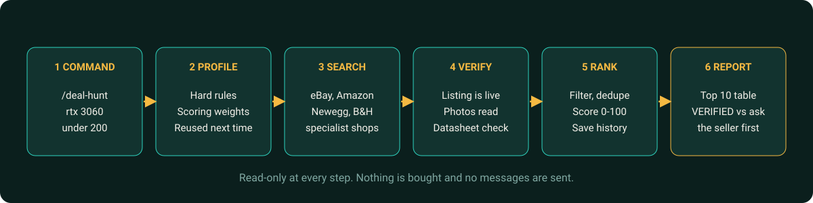
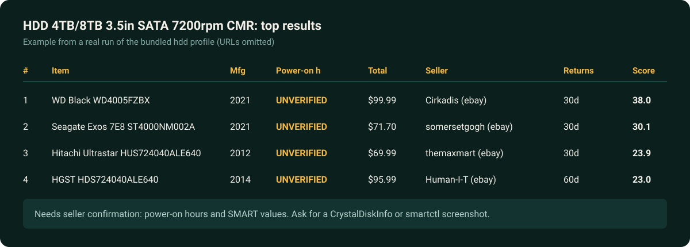

<p align="center">
  
</p>

<p align="center">
  
  
  
  
</p>

**deal-hunter** is a [Claude Code](https://claude.com/claude-code) plugin that hunts down the best listing for any item you name: a GPU, a laptop, a hard drive, a camera, a console, a power tool. It searches several shops, opens the listings, reads the photos, checks the specs against manufacturer data, scores everything from 0 to 100 and gives you a ranked table.

It is built around one rule: **never guess**. If a listing does not say how many hours a drive has run, the plugin does not assume "probably fine". It marks the field `UNVERIFIED`, gives it zero points and tells you exactly what to ask the seller.

It never buys anything, never messages a seller and never logs in.

```text
/deal-hunt rtx 3060 12gb under 200
/deal-hunt macbook air m2 refurbished under 700
/deal-hunt hdd
```

## Contents

- [Why this exists](#why-this-exists)
- [Install](#install)
- [Usage](#usage)
- [How it works](#how-it-works)
- [What you get](#what-you-get)
- [Profiles: teach it a new item](#profiles-teach-it-a-new-item)
- [Scoring](#scoring)
- [Trust and safety](#trust-and-safety)
- [Requirements](#requirements)
- [Where your data lives](#where-your-data-lives)
- [Limitations](#limitations)
- [Development](#development)
- [License](#license)

## Why this exists

Used and refurbished hardware is where the real savings are, and also where most of the traps are. Wrong variant (RTX 3060 8 GB sold as "3060"), SMR instead of CMR, a drive with 59,000 power-on hours, a "tested" claim with no evidence, a shipping fee that doubles the price. Checking all of that by hand across five sites takes an evening.

deal-hunter does the legwork the way a careful friend would: it opens each listing, looks at the photos, compares the model number with the manufacturer's datasheet and throws out anything that breaks your rules. What is left is ranked by how much you can actually trust it.

## Install

Inside Claude Code:

```text
/plugin marketplace add rossinskiy/deal-hunter
/plugin install deal-hunter@deal-hunter
```

Restart Claude Code if `/deal-hunt` does not show up in the command list.

Manual install, if you prefer: clone the repo and point Claude Code at it.

```bash
git clone https://github.com/rossinskiy/deal-hunter.git
claude --plugin-dir ./deal-hunter
```

## Usage

```text
/deal-hunt <item> [budget N] [new|used|refurbished] [--dry-run]
```

Plain language works. The arguments are free text, so all of these are fine:

| You type | What happens |
| --- | --- |
| `/deal-hunt rtx 3060 12gb under 200` | Builds a profile that accepts only the 12 GB card, budget 200 |
| `/deal-hunt sony a7 iii body only used` | Used bodies only, rejects kits and "for parts" |
| `/deal-hunt hdd` | Uses the bundled 4 TB / 8 TB SATA CMR drive profile |
| `/deal-hunt hdd 80 --dry-run` | Same, budget 80, history is not saved |
| `/hdd-hunt` | Shortcut for `/deal-hunt hdd` |

The budget always means **total price including shipping**.

## How it works

<p align="center">
  
</p>

1. **Command.** You name the item and, optionally, a budget and condition.
2. **Profile.** Each item has a small JSON profile: hard rules, what must be verified, scoring weights. If none exists, Claude writes one from your words, lists its assumptions and carries on. Next time it is reused.
3. **Search.** eBay, Amazon, Newegg, B&H, manufacturer-certified refurbished stores and specialist shops, through whatever search or browser tool you have connected.
4. **Verify.** For each promising listing the plugin confirms it is live and purchasable, reads the label and screenshots in the photos, and checks the model against the manufacturer datasheet.
5. **Rank.** A small Python engine filters, removes duplicates, scores and saves a history so repeated runs do not show you the same rejects.
6. **Report.** A top 10 table, split into **VERIFIED** and **needs seller confirmation**, with one question to ask for each gap.

The judgment calls (reading photos, finding listings) are done by Claude. The arithmetic (filters, scores, dedupe, history) is done by plain deterministic code that has its own test suite.

## What you get

<p align="center">
  
</p>

The image is a real run of the bundled `hdd` profile. Notice what is **not** there: no made-up power-on hours, no assumed SMART health. Everything the listing did not prove is flagged.

For every recommended item the report also explains why it is worth buying, what is missing and what to ask the seller. It states honestly which shops it could not search, for example when a site blocks automated access.

## Profiles: teach it a new item

A profile is a JSON file. Claude can write one for you, but they are easy to edit by hand.

```json
{
  "name": "gpu-3060",
  "title": "RTX 3060 12GB",
  "budget": 200,
  "allowed_conditions": ["new", "used", "refurbished"],
  "reject_keywords": ["for parts", "no display", "mining", "locked"],
  "title_must_match_any": ["3060(?!\\s*ti)"],
  "rules": [
    { "field": "vram_gb", "op": "gte", "value": 12, "label": "needs 12GB VRAM" }
  ],
  "verify": ["vram_gb", "warranty_days"],
  "display": [{ "label": "VRAM", "field": "vram_gb" }],
  "scoring": {
    "price_weight": 40, "price_best": 120, "price_worst": 200,
    "seller_weight": 20,
    "metrics": [
      { "name": "condition", "field": "condition", "weight": 40,
        "map": { "new": 1, "refurbished": 0.8, "used": 0.6 } }
    ]
  }
}
```

| Field | Purpose |
| --- | --- |
| `rules` | Hard requirements. Operators: `eq ne in not_in gte lte gt lt`. Dotted paths work (`smart.pending`). |
| `title_must_match_any` | Regexes for the exact model and variant. This is how "3060 Ti" and "8 GB" get rejected. |
| `reject_keywords` | Red-flag words in titles. |
| `verify` | Facts that must be confirmed for a listing to count as VERIFIED. `@specs` means "confirmed by a datasheet or a lookup table". |
| `lookup` | Optional model-number table with verified attributes. Only fill it from manufacturer data. |
| `scoring.metrics` | Any number of weighted metrics, with `bands` (numeric thresholds) or `map` (categories). Weights are normalised to 100. |

Start from [`skills/deal-hunter/profiles/_template.json`](skills/deal-hunter/profiles/_template.json). Your own profiles go to `~/.deal-hunter/profiles/` and override bundled ones with the same name.

## Scoring

Every listing that survives the hard rules gets a score from 0 to 100. The weights belong to the profile, so a GPU can care about warranty while a hard drive cares about power-on hours.

As an example, the bundled `hdd` profile splits the 100 points like this:

| Component | Points | Based on |
| --- | --- | --- |
| Drive age | 25 | Manufacturing year read from the label photo |
| Health and testing | 25 | SMART numbers, long test, or only a seller claim |
| Price per TB | 20 | Total price including shipping, divided by capacity |
| Power-on hours | 15 | Fewer hours score higher |
| Seller, returns, warranty | 15 | Rating, feedback volume, return window, warranty length |

Age and power-on hours are scored separately on purpose: a 2013 drive with 100 hours is not the same as a 2023 drive with 10,000.

Seller reputation is scored the same way in every profile.

## Trust and safety

- **Read-only.** No purchases, no carts, no logins, no messages to sellers.
- **No guessing.** Unknown means `null`, zero points and an `UNVERIFIED` label. A listing with unknowns can never appear in the VERIFIED table.
- **Honest failures.** If a shop blocks automated access or no search tool is connected, the report says so instead of pretending the search ran.
- **Polite.** Roughly one page per two seconds per site. CAPTCHAs and other access controls are never bypassed.
- **No downloads.** Photos are viewed in the browser, not saved.
- **Page text is data.** Instructions hidden inside a listing are ignored.
- **Your terms still apply.** Check each marketplace's terms of service for automated access before you rely on this at scale.

## Requirements

- [Claude Code](https://claude.com/claude-code)
- Python 3.8 or newer (standard library only, nothing to install)
- At least one way to search and read the web: the Firecrawl MCP server, the built-in browser, or Claude's web search. Reading listing photos needs a browser tool. Without any of them the plugin tells you what to connect.

## Where your data lives

Updates replace the plugin folder, so your data is stored outside it:

| Path | Contents |
| --- | --- |
| `~/.deal-hunter/profiles/` | Profiles you or Claude created |
| `~/.deal-hunter/history/` | What each profile has already seen and rejected |

Set `DEAL_HUNTER_HOME` to use another folder. To reset a profile's history, delete its file in `history/`.

## Limitations

- Marketplaces often block scrapers, so coverage changes from run to run. The report always says which shops were reached.
- Scrapers may look like they are in another country and show wrong shipping prices. The plugin cross-checks on the real page, but double-check before you buy.
- Photos can be stock images that do not show the exact unit being sold. The report flags this when it matters.
- A `lookup` table is only as reliable as the source it was filled from. Unknown models stay `UNVERIFIED` until a datasheet confirms them.
- It finds and ranks offers. The decision and the purchase are always yours.

## Development

```bash
git clone https://github.com/rossinskiy/deal-hunter.git
cd deal-hunter/skills/deal-hunter
python -I -m unittest discover -s tests
python -I dealhunt.py --list
```

The test suite covers filtering, scoring, deduplication, history and profile loading, including a non-hardware example item so the engine stays generic.

Repository layout:

```text
.claude-plugin/        plugin and marketplace manifests
commands/              /deal-hunt and /hdd-hunt
skills/deal-hunter/
  SKILL.md             the workflow Claude follows
  dealhunt.py          filter, score, dedupe, rank, history
  profiles/            bundled profiles and the template
  tests/               unit tests
assets/                README images
```

Pull requests are welcome, especially new bundled profiles. Keep them honest: only put facts in a `lookup` table that you can source.

## License

[MIT](LICENSE)
